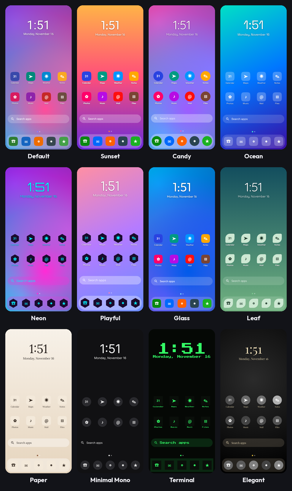
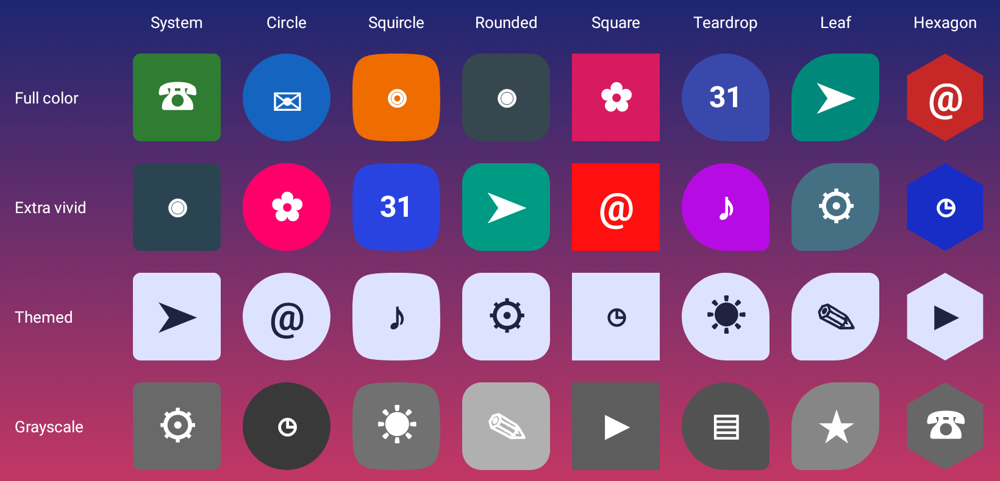
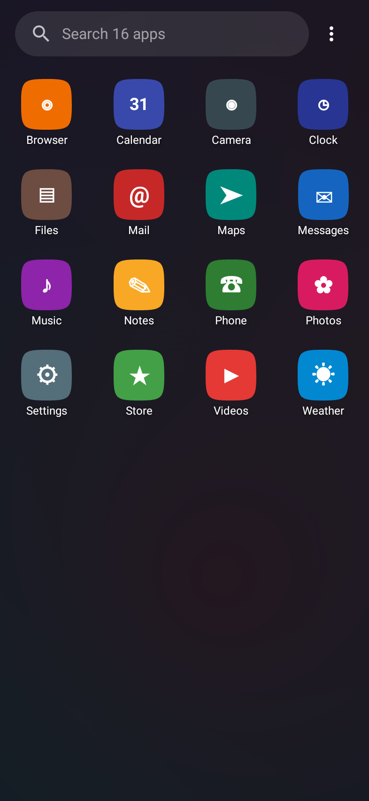
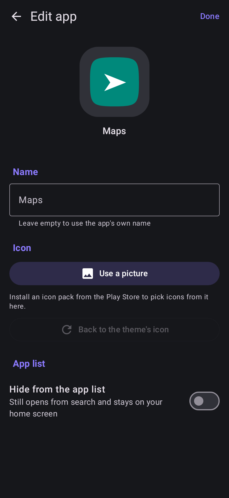
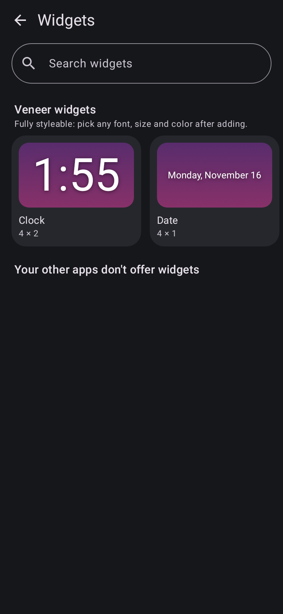
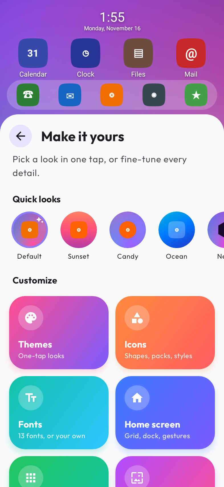
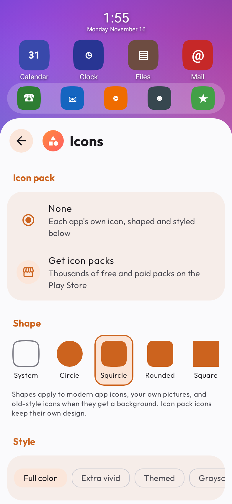
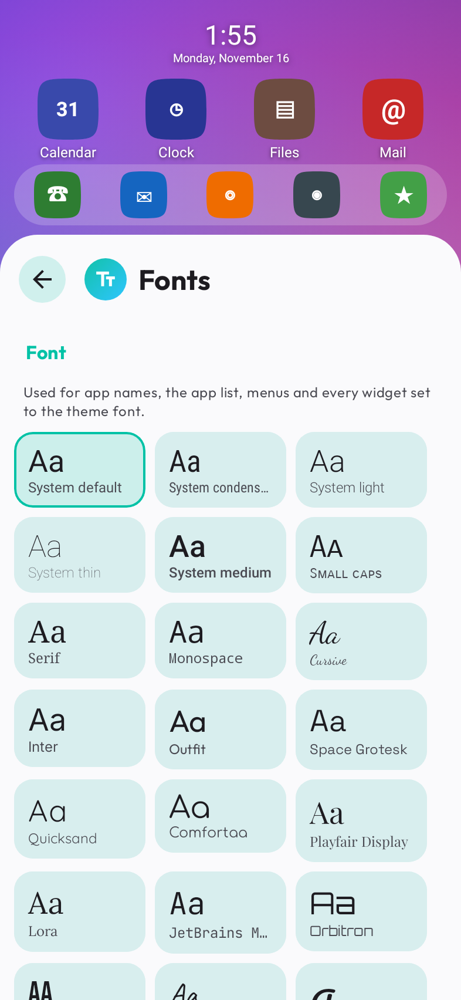

# Veneer

A home-screen app for Android that lets you restyle what you see every day: every app icon, the fonts, the widgets, the app list, the wallpaper and the system colors that follow it.





| App list | Edit one app | Widgets |
| --- | --- | --- |
|  |  |  |

| Customize | Icons | Fonts |
| --- | --- | --- |
|  |  |  |

The screenshots are produced by the test suite (see [Building](#building)), with sample apps and a generated wallpaper.

## What you can change

**Icons**
- Any icon pack in the common ADW/Nova format (most packs on the Play Store), including packs that theme apps they don't cover.
- Eight shapes: system, circle, squircle, rounded, square, teardrop, leaf, hexagon.
- Full color, extra vivid (turns up every icon's colors), grayscale, or themed: one-color symbols in your own two colors, using the one-color icons apps ship for Android 13 and newer, and a tinted logo for many apps that don't.
- Icon size, and a matching background for old-style square icons.
- Per app: an icon from any pack, your own picture, a new name, or hide it from the app list.

**Fonts**
- 13 bundled fonts (Inter, Outfit, Space Grotesk, Quicksand, Comfortaa, Playfair Display, Lora, JetBrains Mono, Orbitron, Bebas Neue, Caveat, Pacifico, Press Start 2P) plus the phone's built-in families.
- Import any `.ttf` or `.otf` file from your phone.
- App name size, color, weight and shadow, or hide names entirely.

**Widgets**
- Any widget from your other apps: add, move, resize, open its settings.
- Veneer's own widgets: clock, date, clock with date, greeting, text, search bar and battery. Each one has its own font, size, color, alignment, background and roundness.

**Home screen, dock and app list**
- Grid from 3×3 to 8×10, any number of pages, page dots.
- Dock with 3 to 7 apps, any color or opacity, any roundness, or no dock.
- Darken the wallpaper, hide the status bar or pick light or dark status bar icons.
- App list columns, background and text color.

**Wallpaper and system colors**
- Set a picture as wallpaper, or generate one: solid, vertical, diagonal, glow, or aurora (soft overlapping glows), with two or three colors.
- On Android 12 and newer the phone takes its system colors (quick settings, Settings, keyboard, Material You apps) from the wallpaper, so the gradient maker doubles as a system color picker.

**Themes**
- Twelve ready-made looks, each with a matching wallpaper: Default, Sunset, Candy, Ocean, Neon, Playful, Glass, Leaf, Paper, Minimal Mono, Terminal, Elegant.
- Save your own looks, export them to a file to share, import theme files.
- Back up and restore your whole setup.

## What Android doesn't allow

No app can restyle the system itself or the inside of other apps, so Veneer works as your home screen:

- **System UI** (quick settings, the Settings app, the keyboard): only through wallpaper colors on Android 12+.
- **System font** (the font inside other apps): only your phone's own settings can change it. Samsung, Xiaomi, OPPO, vivo, OnePlus and others have a font picker there, and Veneer links to it.
- **Icons elsewhere** (notifications, the share sheet, recent apps) come from the system and keep their original look.

## Install

1. Download `app-release.apk` to your phone and open it. Allow your browser or file manager to install apps when Android asks.
2. Open **Veneer** from your app list and tap **Set as home app**.
3. Press the home button.

To switch back, go to Settings → Apps → Default apps → Home app.

## Using it

| Do this | To get |
| --- | --- |
| Swipe up | The app list (with search) |
| Swipe down | Notifications |
| Hold an empty spot | Widgets, wallpaper, Customize, add or remove pages |
| Hold an app or widget | Its menu; keep holding and drag to move it, or drop it on the dock |
| Hold near the screen edge while dragging | Move to the next page |
| Hold an app in the app list | Add to home, change icon or name, hide, uninstall |
| Tap the clock, date or battery widget | Alarms, calendar, battery settings |

**Veneer** in the app list opens all the customization screens.

## Building

Needs JDK 17 or newer and the Android SDK (platform 37, build-tools 37). Put the SDK path in `local.properties` (`sdk.dir=...`) or `ANDROID_HOME`.

```bash
./gradlew :app:assembleRelease      # app/build/outputs/apk/release/app-release.apk
./gradlew :app:testDebugUnitTest    # unit and Robolectric UI tests; writes docs/screenshots/
```

The UI tests run the real home screen and customization screens in Robolectric with native graphics: launching, swiping to the app list, searching, long-press menus, drag-and-drop, applying presets and rendering every icon shape and style.

Builds are signed with `app/debug.keystore`, a project-specific debug key committed on purpose so every build installs over the previous one. Use your own private key before publishing to a store.

## Project layout

| Path | What it holds |
| --- | --- |
| `data/` | Saved state (theme, layout, per-app changes), grid placement logic, theme presets |
| `apps/` | The list of installed apps across profiles, launching, uninstalling |
| `icons/` | Icon shapes, rendering (shapes, themed, grayscale), icon pack parsing, icon cache |
| `fonts/` | Built-in, bundled and imported fonts |
| `widgets/` | Hosting other apps' widgets |
| `system/` | Wallpaper generation, notification shade, system settings shortcuts |
| `ui/launcher/` | Home screen, dock, drag and drop, app list, widget picker, Veneer widgets |
| `ui/customize/` | Every customization screen with its live preview |
| `ui/common/` | Shared controls, color picker, font picker, per-app editor |

## Licenses

The bundled fonts are under the SIL Open Font License 1.1; their full license texts are in `app/src/main/assets/font_licenses.txt` and shown in the app under Backup and about.
